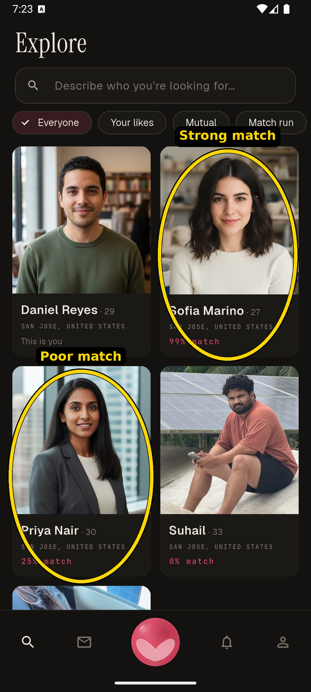
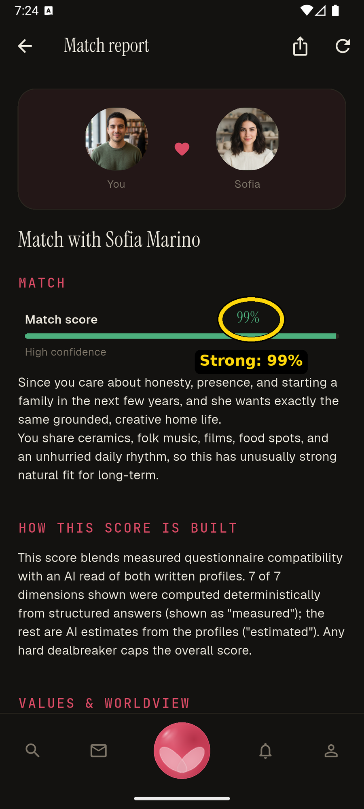
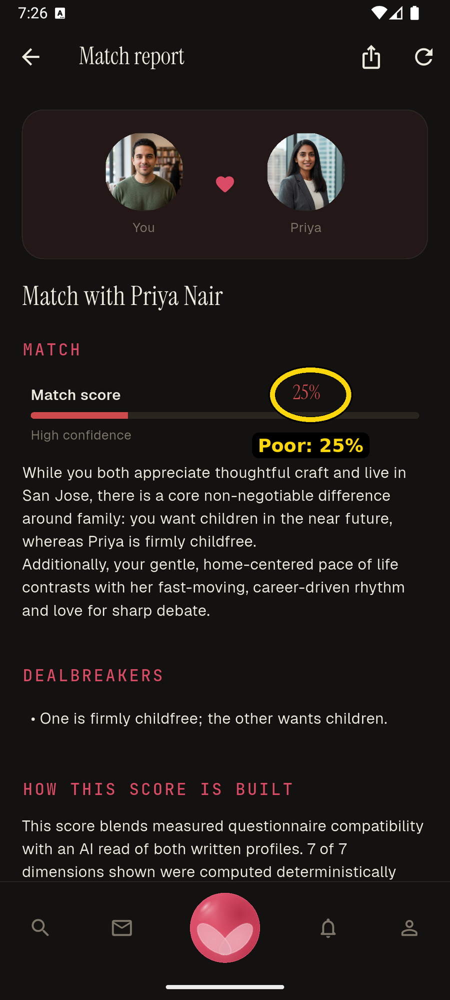
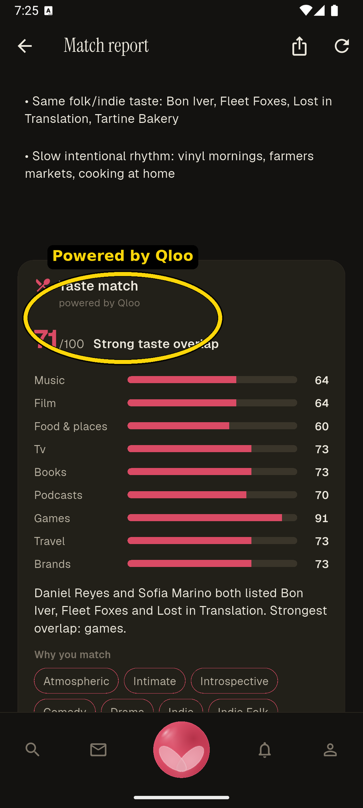
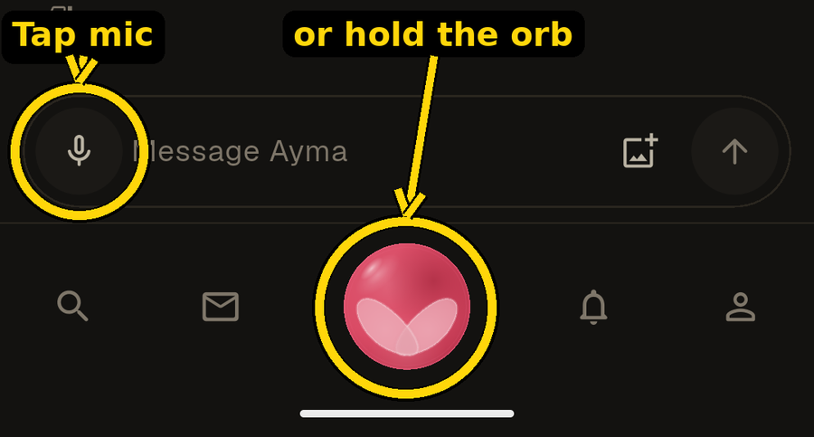

# ayma-taste-qloo

**Taste match, powered by Qloo** — the Qloo-built subset of **Ayma**, extracted
for the **Qloo Agentic Hackathon** (October 2026).

Ayma is a voice-first AI dating companion — the whole app is voice-controlled, so
you can navigate anywhere and take any action just by talking to Ayma. Two people
each build up their taste profile by talking with Ayma. When they're in a match report together, Ayma
gives them their **taste match** and **taste-based date ideas** — powered by
**Qloo**: Ayma turns each person's stated tastes across **ten domains** into a
**shared-taste score**, the **tastes and taste-descriptors they have in common**,
an **audience read**, and date ideas (a place, a film, an artist, a game… that
Qloo's taste graph ranks highly for *both* of them at once).

In spirit, it's a first real step toward the world of Black Mirror's "Hang the
DJ" — a system that learns who you are and finds who you'd actually click with.

This repository contains **only** the components that call the **Qloo Taste /
Insights API**. Everything else in Ayma — auth, matching, the Firestore data
layer, the Gemini client, the voice-agent worker, the Flutter app shell — is
private and is **not** included here.

Nobody in this repo is a real person; all demo profiles are fabricated.

---

## Why this is agentic, and why Qloo is load-bearing

In Ayma the taste match is **a tool in an agent's hands**, not a standalone
widget. Ayma (the agent) calls the Qloo taste match as a tool — both in
conversation and when it builds the **match report** ("Taste match · powered by
Qloo") — to decide how two people fit and *where the two of them would actually
click*: a shared place to meet, a film to see, a record to put on. The agent
decides *when* to pull taste into the conversation; **Qloo supplies the taste
reasoning.**

The differentiator is **cross-domain taste affinity**. Qloo's graph knows that
someone who loves *Khruangbin* and *Spirited Away* is statistically drawn to a
particular kind of café, film, and author — connections across unrelated domains
that no keyword match, embedding of our own, or LLM guess reproduces reliably.
Remove Qloo and the feature doesn't degrade gracefully — it stops being what it
is. Every recommendation, every per-domain score, and every date idea in this
repo is driven by a live Qloo Insights call.

---

## Judges — try the live demo (2 minutes)

The live product runs on **TestFlight** (iOS) and as an Android APK:

**1. Install:**

- **iOS (TestFlight):** <https://testflight.apple.com/join/uceuSRkh>
- **Android (sideload the APK):** <https://github.com/suhailps93/ayma-taste-qloo/releases/latest/download/ayma-android.apk> — enable "install unknown apps", install, then log in with the same `test1@gmail.com` / `Test123` below.

**2. Log in** with the throwaway demo account:

| | |
|---|---|
| Email | `test1@gmail.com` |
| Password | `Test123` |

(Public demo credentials — this is a disposable account seeded with fabricated
profiles, nothing real.)

**3. See a strong match vs a poor match.** Open **Explore** and tap a profile card:

- **Sofia Marino** → a **strong** taste match.
- **Priya Nair** → a **poor** taste match.



*In Explore, tap a profile card — Sofia Marino (strong, 99%) or Priya Nair (poor, 25%).*

Each opens a **match report**. Sofia's lands at a **99%** fit; Priya's is an honest
**25%**, capped by a dealbreaker — Ayma tells you *why* it's low:



*Sofia Marino — a 99% match, "high confidence."*



*Priya Nair — 25%; the honest contrast, with the dealbreaker spelled out.*

**4. Open the Qloo breakdown.** On the match report, scroll to the bottom and open
the **"Taste match · powered by Qloo"** card. It shows the overall score, the
per-domain bars, the shared tastes, the "why you match" taste descriptors, and the
Qloo-ranked date ideas — all from the live Qloo Insights API.



*The "Taste match · powered by Qloo" card: the 71/100 score, per-domain bars across
all ten domains, the shared tastes, and the taste descriptors — every number from a
live Qloo Insights call.*

**5. Try it hands-free.** The whole app is voice-controlled — you can navigate
anywhere and take any action just by talking. To start voice, tap the
**microphone** button, or **press and hold the Ayma orb** in the bottom bar, then
speak — e.g. *"open Sofia's profile"* or *"show our match report."*



*Two ways to start voice: tap the mic in the composer, or press and hold the Ayma
orb in the bottom bar.*

---

## Run the extracted engine yourself (no key, no database, no network)

The actual taste-match code runs standalone on a bundled offline fixture:

```bash
cd backend
python3 -m pip install -r requirements-test.txt
python3 demo_taste.py
```

You'll see the full pipeline on two sample people — **stated tastes → Qloo →
score + shared tastes + date ideas** — on the offline fixture (`source: fixture`).
To run it against the **live Qloo Insights API**, export a key first:

```bash
export QLOO_API_KEY=<your Qloo Insights key>
python3 demo_taste.py            # now prints source: qloo
```

`python3 demo_taste.py A.txt B.txt` runs it on two text files, each containing
`Music: …`, `Film: …`, `Food: …` (and, optionally, any of the other domain lines
below).

Run the test suite the same way:

```bash
cd backend
python3 -m pip install -r requirements-test.txt
python3 -m pytest -q          # 9 passed, no key / network needed
```

---

## The ten taste domains

Every name a person lists is resolved to a Qloo entity of its domain's type, and
each domain is scored on Qloo's cross-domain recommendations. Music, Film and
Food are the core three; the other seven are **additive** — scored only when both
people list that domain, and absent (with zero extra Qloo calls) otherwise.

| Domain | Qloo entity type | Taste-page headers parsed (case-insensitive) |
|---|---|---|
| Music | `urn:entity:artist` | Music, Artists, Bands |
| Film | `urn:entity:movie` | Film, Films, Movie, Movies |
| Food & places | `urn:entity:place` | Dining, Food, Places, Restaurants, Cafes |
| TV | `urn:entity:tv_show` | TV, TV shows, Shows, Television, Series |
| Books | `urn:entity:book` | Books, Book, Reading, Authors |
| Podcasts | `urn:entity:podcast` | Podcasts, Podcast |
| Games | `urn:entity:videogame` | Games, Game, Video games, Gaming |
| Travel | `urn:entity:destination` | Travel, Destinations, Trips, Places to go |
| Fashion & brands | `urn:entity:brand` | Brands, Brand, Fashion, Style |
| Nightlife | `urn:entity:place` + nightlife tag | Nightlife, Bars, Clubs, Going out |

---

## How the Qloo integration works

The engine is `backend/qloo_client.py` (the Qloo API client) and
`backend/taste_match.py` (the taste-match logic). All calls are `GET` with an
`X-Api-Key` header against the Qloo Insights host. For a pair of people:

1. **Taste signals.** Each person's public favourites are parsed from their Taste
   page (`Music:`, `Film:`, `Food:`, and any of the domain headers above), up to 5
   names per domain (`taste_match.parse_taste`).

2. **Resolve to Qloo entities.** Every name is resolved to a Qloo entity of its
   domain's type via **`GET /search`** (`query`, `types`). Resolved entities carry
   their Qloo `tags` (names) and `tag_ids` (URNs).

3. **Compatibility (per domain).** For each domain **both** people listed,
   **`GET /v2/insights`** returns Qloo's taste-graph recommendations driven by
   **all** of a person's resolved entities (`signal.interests.entities` — so every
   recommendation is **cross-domain**, not just same-domain). A domain's score is
   the **overlap coefficient** of person A's and person B's recommendation sets
   (each set being that person's stated entities plus their recs) × 100; the
   overall score is the mean across both-stated domains. Labels: ≥70 strong · ≥45
   good · ≥25 some · else different. Shared tastes are only the names both people
   listed outright.

4. **Why you match (shared tags).** **`GET /v2/insights`** with
   `filter.type=urn:tag` returns Qloo's affinity-ranked tags for each whole taste
   profile; the engine intersects the two into readable descriptors
   ("Atmospheric", "Melancholic", "Psychedelic") — the explainability of the match.

5. **Audience read (demographics).** **`GET /v2/insights`** with
   `filter.type=urn:demographics` returns Qloo's signed age/gender over-/under-index
   for each taste entity, averaged into one read per person. **Only taste entity
   ids are sent — never any user identity.**

6. **Date ideas.** One joint **`GET /v2/insights`** for `urn:entity:place` driven
   by **both** people's entities at once, filtered to the first person's city
   (`filter.location.query`) and tag-aligned to both (`filter.tags`), yields the
   top places; the top joint pick in each other present domain (film → "movie
   night", music → "listening date", games → "game night", travel → "weekend
   trip", …) that neither person already listed becomes a date idea.

Response shape:

```json
{
  "source": "qloo | fixture",
  "a": {"name": "…"}, "b": {"name": "…"},
  "score": 72, "score_label": "Strong taste match",
  "summary": "…",
  "shared": ["Khruangbin", "Spirited Away"],
  "shared_tags": ["Atmospheric", "Melancholic"],
  "demographics": {"a": {…}, "b": {…}, "note": "…"},
  "domains": [{"domain": "music", "score": 62}, …],
  "date_ideas": [{"name": "…", "kind": "dining", "why": "…", "address": "…"}]
}
```

See **`docs/QLOO_TASTE.md`** for the full Qloo API surface, scoring details, the
live-vs-fixture fallback, and the privacy model.

---

## What's here

```
backend/
  qloo_client.py        Qloo Taste/Insights API client: LiveQlooClient (real API,
                        X-Api-Key + /search + /v2/insights, process-wide rate pacing
                        + 429 retry) and FixtureQlooClient (offline). Same shapes.
  taste_match.py        The taste-match logic (parse -> resolve -> per-domain overlap
                        -> score + shared + tags + demographics + date ideas), the
                        HTTP router, and the match-report section.
  qloo_fixture.json     72 real, well-known entities across all ten domains
                        (illustrative tags, NOT Qloo data) so the demo + tests run
                        with no key and no network.
  config.py             The two non-secret Qloo config fields (base URL, timeout).
  demo_taste.py         Standalone runnable demo (tastes -> score + ideas).
  _stubs/               Test-only stand-ins for Ayma's private core (see its README).
  tests/                Self-contained tests (fixture + FakeDb, no network).
docs/
  QLOO_TASTE.md         Full design: domains, signals, scoring, live-vs-fixture,
                        privacy, API.
EXTRACTION_INVENTORY.md Every file, its origin, and every stubbed dependency.
LICENSE / NOTICE        Apache-2.0.
```

`qloo_client.py`, `taste_match.py`, `config.py`, `demo_taste.py` and the tests run
**standalone** — fixture + `FakeDb`, no key, no Firestore, no network.
`taste_match.py`'s HTTP router references Ayma's private auth, the Firestore `db`
handle, and the 18+ age gate; those are **documented as external** and reproduced
only by the small stand-ins in `backend/_stubs/` (loaded by the tests and the demo,
never in production). See **`EXTRACTION_INVENTORY.md`** for a file-by-file origin
and every stubbed dependency.

---

## Safety & cost

- **Public profile data only.** Only taste names a person publishes are ever sent
  to Qloo — never private pages, contact details, location coordinates, or the
  caller's own private data. The demographics call sends **only taste entity ids**,
  never user identity (name, uid, birthdate, gender, location).
- **18+.** The signed-in pair endpoint is gated to adults.

## License

Apache-2.0 — see [`LICENSE`](LICENSE) and [`NOTICE`](NOTICE).
